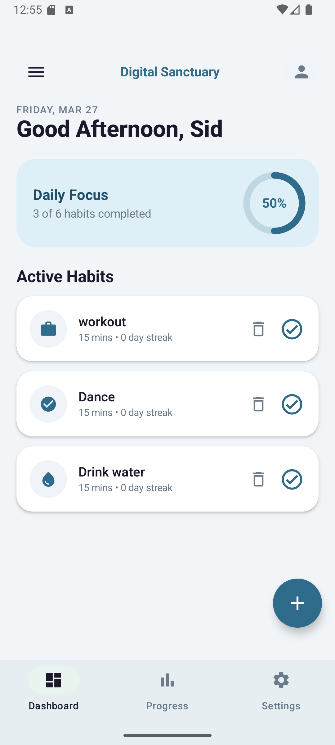
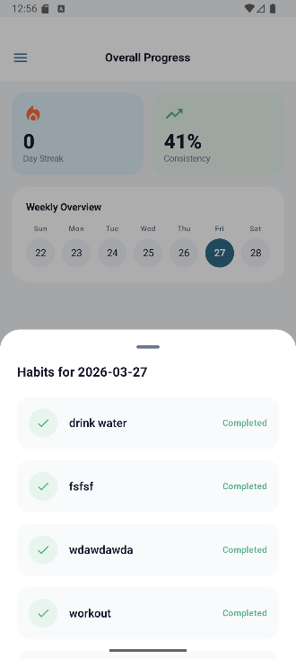
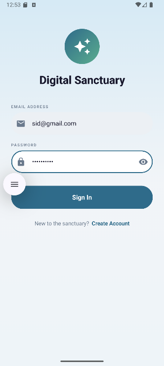
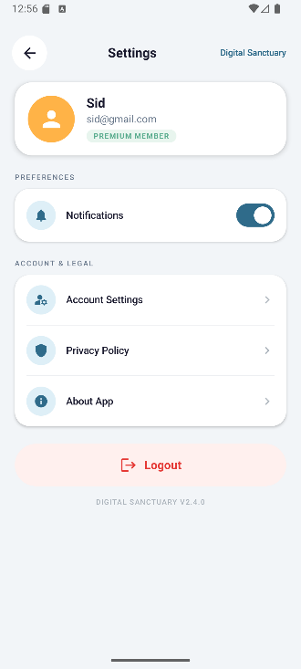

# Habit Tracker: Digital Sanctuary

An Android habit-tracking app built with **Kotlin** and **Jetpack Compose**. Create daily habits, tick them off, watch your streaks grow, and keep a short journal with moods, all in a calm soft-blue design with dark mode.

Built as an MCA mini project for *Mobile Application Development using Android* at AIMIT, St Aloysius (Deemed to be University), Mangaluru, by **Siddharth Bhat** and **Megha Raykar**.

| Dashboard | Progress | Sign in | Settings |
|---|---|---|---|
|  |  |  |  |

## Features

- **Dashboard:** time-of-day greeting, a "Daily Focus" progress ring, and your active habits with one-tap completion
- **Habits:** create a habit, track current and longest streak, open a detail screen for each one
- **Progress:** day streak, consistency percentage and a weekly overview; tap a day to see what you completed
- **Journal:** write entries with a mood and delete them
- **Settings:** dark mode, notification reminders, account settings, privacy policy and an About screen
- **First-run flow:** animated splash screen, 3-page onboarding, register, sign in and forgot password
- **Navigation drawer** and bottom bar (Dashboard, Progress, Settings)

## Tech stack

| Area | What is used |
|---|---|
| Language | Kotlin 2.0.21 |
| UI | Jetpack Compose (BOM 2024.10.01), Material 3, Material Icons Extended |
| Navigation | Navigation Compose 2.8.3 |
| Architecture | MVVM with ViewModels, Repositories, Kotlin Coroutines and Flow |
| Database | Room 2.6.1 (habits, completions, journal entries) |
| Settings and session | DataStore Preferences 1.1.1 |
| Images | Coil |
| Build | Gradle (Kotlin DSL), AGP 8.13.2, minSdk 28, targetSdk 35 |

## Run it

1. Install **Android Studio** and clone this repo:
   ```bash
   git clone https://github.com/SiddharthBhat120/HabitTracker.git
   ```
2. In Android Studio choose **File → Open** and select the project folder. Wait for the Gradle sync to finish.
3. Start an emulator or connect a phone (Android 9 / API 28 or newer) and press **Run**.

Android Studio creates `local.properties` with your SDK path automatically. That file is ignored by Git.

## Project structure

```
app/src/main/java/com/digitalsanctuary/habittracker/
├── data/
│   ├── local/        Room database, DAOs and entities
│   └── repository/   Habit, journal and auth repositories
├── navigation/       NavGraph and Screen routes
├── ui/
│   ├── components/   Shared composables
│   ├── screens/      All Compose screens
│   └── theme/        Colors, typography, theme
├── utils/            PreferencesManager, DateUtils, NotificationHelper
├── viewmodel/        Habit, Auth, Progress and Settings ViewModels
└── MainActivity.kt
```

## Notes

- Accounts and data are stored **on the device only** (Room and DataStore). There is no cloud sync or server, so this is a learning project and not meant for real user passwords.

## Authors

- **Siddharth Bhat**: [GitHub @SiddharthBhat120](https://github.com/SiddharthBhat120)
- **Megha Raykar**
